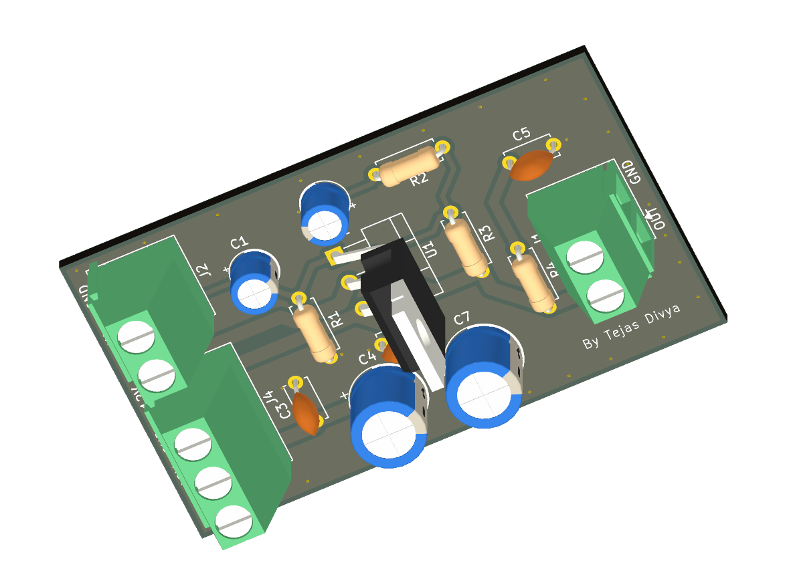
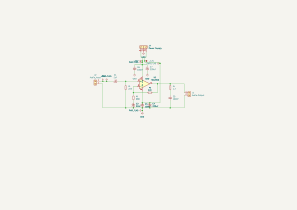
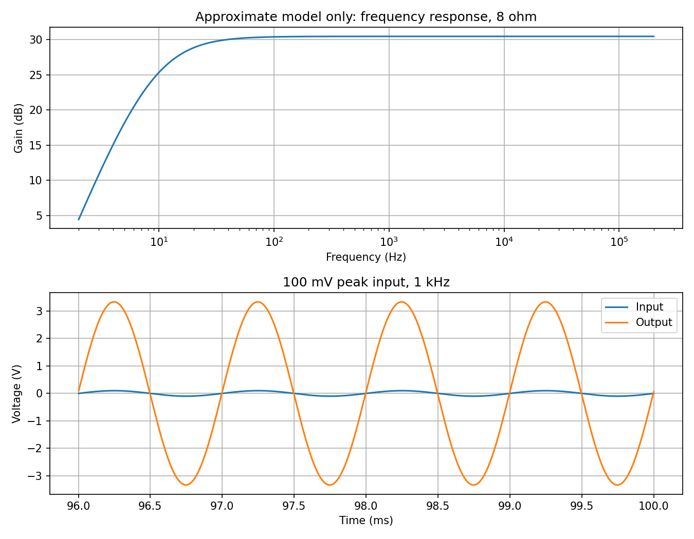

# 25W Audio Amplifier Pcb design

Revision 2 of a mono TDA2050 audio amplifier designed in **KiCad 9**, with a two-layer PCB,
schematic, SPICE experiments, and audio-file input/output waveform results.
The 25W project title does not represent a verified output power for this board.

**Status: design and simulation prototype.** The saved design has a reversed
negative-rail capacitor (C4): correct its polarity before fabrication or power-up.
See [design review](simulation/PCB-before-ordering.md) for the other open items.
The simulation uses an educational behavioural model; results are not measured
hardware specifications or a manufacturer-validated TDA2050 simulation.

## PCB and schematic



| Top copper and silkscreen | Bottom copper (mirrored) |
| --- | --- |
|  |  |



[Schematic PDF](docs/previews/schematic.pdf) · [KiCad schematic](25W-Audio-Amplifier-Pcb-design.kicad_sch) ·
[KiCad PCB](25W-Audio-Amplifier-Pcb-design.kicad_pcb) · [Project settings](25W-Audio-Amplifier-Pcb-design.kicad_pro)

## Design specifications

| Parameter | Saved design / simulation setting |
| --- | --- |
| Amplifier | TDA2050, mono, noninverting configuration |
| Supply | Split +12 V / GND / −12 V used in simulation |
| PCB dimensions | 60 × 35 mm |
| Copper layers | 2: F.Cu and B.Cu |
| Nominal board thickness | 1.6 mm |
| Assembly | Through-hole components |
| Supply / principal output trace width | 1.5 mm; no current rating established |
| Feedback resistors | R3 = 22 kΩ, R2 = 680 Ω |
| Nominal midband feedback gain | 1 + 22000/680 ≈ 33.35 V/V (30.46 dB) |
| Input coupling / input resistance | C1 = 1 µF / R1 = 22 kΩ |
| Feedback capacitor | C2 = 22 µF |
| Supply bypass | C3, C6 = 100 nF; C4, C7 = 220 µF |
| Output series RC network | R4 = 4.7 Ω, C5 = 100 nF |
| Simulated loads | 4 Ω and 8 Ω resistors |
| Validated hardware power / bandwidth / THD | Not measured or established |

### Connections

| Connector | Pin assignments |
| --- | --- |
| J2 — audio input | 1: GND; 2: audio signal (currently mislabeled `+5V`) |
| J1 — speaker/load output | 1: amplifier output; 2: GND |
| J4 — split supply | 1: +12 V; 2: GND; 3: −12 V |

The `+5V` net label on J2 is the audio input in this project, not a simulated
5 V supply. U1 pins are 1: noninverting input, 2: inverting input, 3: negative
supply, 4: output, 5: positive supply.

### Components

| Reference | Value / part | Role |
| --- | --- | --- |
| U1 | TDA2050 | Power amplifier |
| R1 | 22 kΩ | Input bias return |
| R2 | 680 Ω | Feedback ground leg |
| R3 | 22 kΩ | Output feedback |
| R4 | 4.7 Ω | Output RC network resistor |
| C1 | 1 µF | Input coupling |
| C2 | 22 µF | Feedback DC blocking |
| C3, C6 | 100 nF | Supply bypass |
| C4, C7 | 220 µF | Supply bulk decoupling |
| C5 | 100 nF | Output RC network capacitor |
| J1, J2 | 2-pin, 5 mm pitch terminal blocks | Output and input |
| J4 | 3-pin, 5 mm pitch terminal block | Split supply |

[Full BOM with assigned footprints](docs/BOM.csv). Voltage ratings, resistor
power ratings and the exact U1 package fit still need verification; the BOM
records the saved design rather than a purchasing specification.

## Simulation results

### Sine-wave tests

At 1 kHz and 0.1 V peak input:

| Load | Gain | Output peak | Output RMS | Mean load power |
| --- | --- | --- | --- | --- |
| 8 Ω | 33.339 V/V | 3.335 V | 2.357 V | 0.695 W |
| 4 Ω | 33.339 V/V | 3.335 V | 2.357 V | 1.389 W |



The repository also includes 0.5 V peak overdrive tests. Their clipped waveform
power is not a clean rated output-power specification. Raw results are in
[results.json](simulation/results.json) and the `*_ac.txt`, `*_tran.txt` and
`*_op.txt` files.

### Synthetic audio input

The audio runner also includes a [synthetic 1 kHz input/output example](simulation/audio_demo/waveforms.png).
The plotted output is a model result with an 8 Ω resistive load.

### Reproduce

Open `25W-Audio-Amplifier-Pcb-design.kicad_pro` in KiCad 9 with the standard symbol and footprint
libraries. For simulations, use Python 3 with NumPy, SciPy, Matplotlib and the
ngspice shared library (`libngspice.so.0` on the tested Linux system).

```sh
PYTHONNOUSERSITE=1 MPLCONFIGDIR=/tmp/pcb-simulation-mpl python3 simulation/run_simulation.py
```

For your own WAV recording:

```sh
PYTHONNOUSERSITE=1 python3 simulation/audio_simulation.py /path/to/audio.wav --start 0 --duration 1 --input-peak 0.1 --load 8 --out simulation/my_audio_results
```

Long audio runs can be slow. PCM and floating-point WAV are supported; convert
other formats to WAV before running. See [simulation instructions](simulation/README.md)
for netlist refresh and interactive KiCad setup. The audio runner reads the saved
`small_8ohm.cir` connectivity, so regenerate it after relevant schematic changes.

## Model limitations and open design work

The behavioural amplifier has 100,000 V/V small-signal open-loop gain, a fixed
approximately ±10 V smooth limiter and 0.1 Ω output resistance. It does not model
frequency compensation, slew rate, current protection, noise, thermal behaviour
or PCB parasitics. Changing supply voltages does not change its limiter.
It cannot establish real stability, safe maximum power or heatsink requirements.

Before building, resolve the items documented in [PCB-before-ordering.md](simulation/PCB-before-ordering.md):

- Reverse C4's design polarity so its positive terminal faces ground and its
  negative terminal faces −12 V, including PCB markings.
- Rename the audio input net and verify component ratings and the exact U1
  footprint against the purchased part.
- Review the output RC network, bypass placement, high-current ground returns
  and heatsink arrangement.
- Synchronize schematic/PCB values, refill zones and repeat ERC/DRC.

KiCad 9.0.9 checks on the saved revision 2 design found zero schematic ERC
violations and zero unconnected pads. PCB DRC reported three silkscreen overlap
warnings. The schematic-to-PCB comparison reported five warnings: two pad net
mismatches involving `IN` and `+5V`, and three connector value mismatches.
See the [ERC report](docs/checks/tda2050-erc.rpt) and
[DRC report](docs/checks/tda2050-drc.rpt). Fabrication exports are pending the
C4 polarity correction and layout review.

## Repository contents

| Path | Contents |
| --- | --- |
| `25W-Audio-Amplifier-Pcb-design.kicad_pro`, `.kicad_sch`, `.kicad_pcb` | Main editable KiCad design |
| `docs/` | Preview exports, schematic PDF and BOM |
| `simulation/` | Python runners, model, netlist, SPICE decks, plots, audio and raw data |
| `gnd-via-example/` | Separate ground-stitching PCB example, preview and DRC report |
| `25W-Audio-Amplifier-Pcb-design.wbk` | KiCad simulation workbook with operating-point setup |

Transient editor locks, local preferences and footprint caches are excluded.
The KiCad files are from the saved revision 2 design.

## Attribution and licensing

No project license has been selected.
